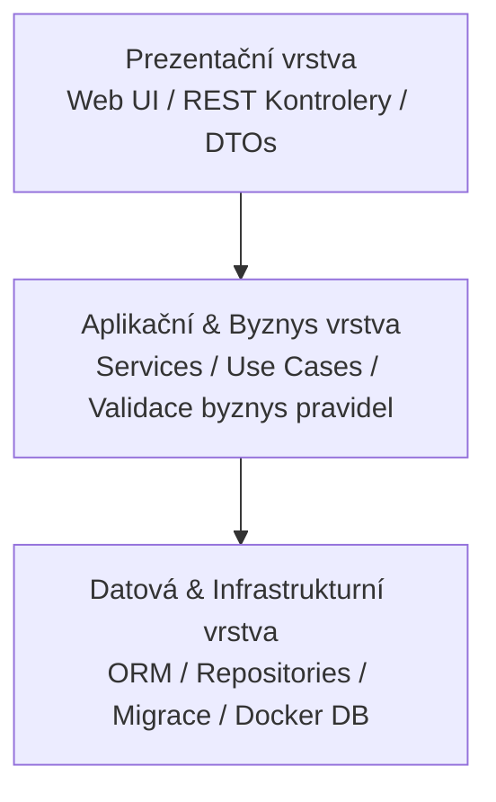

# Semestrální projekt PPRO – Pokročilé programování

**Předmět:** Pokročilé programování (PPRO)  
**Semestr:** Zimní semestr 2026/2027  
**Instituce:** Fakulta informatiky a managementu, Univerzita Hradec Králové  
**Konzultace vyučujícího:** Dominik Palla (`dominik.palla@uhk.cz`)  
**Autor projektu:** sirokvo1  
**Stav dokumentu:** Jediný zdroj pravdy (Single Source of Truth – SSOT)

---

## 1. Povinné společné minimum projektu

Aplikace musí splňovat následující kritéria definovaná zadáním:

- [ ] **Tři vrstvy se závislostmi jedním směrem:**
  - *Prezentační vrstva* (UI / REST API kontrolery)
  - *Aplikační / Byznys vrstva* (služby, validace byznys logiky, doménové operace)
  - *Datová / Infrastrukturní vrstva* (databázový přístup, repozitáře, perzistence)
  - Závislosti striktně jednosměrné (Prezentace $\rightarrow$ Byznys $\rightarrow$ Data).
- [ ] **Relační databáze v Dockeru s migracemi:** Schéma verze řízeno striktně migračními skripty.
- [ ] **Datový model:** Nejméně **5 doménových entit** a alespoň **jedna vazba M:N**.
- [ ] **Automatizované testy:** Testy byznys pravidel a integrity dat.
- [ ] **Spuštění jedním příkazem:** Kompletní stack musí být spustitelný přes `docker compose up`.
- [ ] **Syntetická data:** Pouze bezpečná, syntetická testovací data (žádná reálná data, žádné přístupové údaje v gitu).
- [ ] **Technická dokumentace:** Tento soubor (`README.md`) udržovaný jako aktuální zdroj pravdy.

---

## 2. Výběr klientského zadání

> [!IMPORTANT]
> Volbu konkrétního zadání je nutné potvrdit **nejpozději na 4. cvičení** společně s návrhem datového modelu.

Níže je přehled 4 klientských zadání ze zadání předmětu:

- [ ] **Zadání A: Rezervace v ordinaci** *(MUDr. Jana Hrubá, Ordinace Na Vyhlídce)*  
  *Kde se láme návrh:* Překrývání termínů a význam zrušené rezervace.
- [ ] **Zadání B: Sklad pro malý e-shop** *(Petr Doležal, Dřevěnka s.r.o.)*  
  *Kde se láme návrh:* Okamžik odečtení zásoby a dohledatelnost pohybů.
- [ ] **Zadání C: Kurzy vzdělávacího centra** *(Ing. Lucie Bartošová, Akademie Trutnov)*  
  *Kde se láme návrh:* Pořadník a pravidlo dokončení kurzu.
- [x] **Zadání D: Půjčovna vybavení** *(Martin Řehák, Hory a voda)* – **ZVOLENO PRO IMPLEMENTACI**  
  *Kde se láme návrh:* Rezervace konkrétního kusu proti rezervaci typu.  
  *Technologický stack:* **React 18 + Vite + TypeScript (UI)** + **Python FastAPI (Backend)** + **PostgreSQL 16 (Docker)**  
  *Průběžný seznam úkolů:* [TODO.md](file:///p:/ppro/project/TODO.md)

---

## 3. Detailní specifikace jednotlivých zadání

<details>
<summary><strong>Rozbalit Zadání A: Rezervace v ordinaci</strong></summary>

### Klient
**MUDr. Jana Hrubá, Ordinace Na Vyhlídce.** Soukromá praxe, tři lékaři na částečné úvazky a paní Věra na recepci. Cca 900 pacientů (polovina pravidelných).

### Současný stav
Papírový diář na recepci, zápis tužkou. Při nemoci lékaře ruční obvolávání. Na konci měsíce ruční přepis výkonů do tabulky pojišťovny (celý podvečer). Problém: občasný souběh dvou pacientů na stejný čas.

### Co klient chce
1. **Pacienti v evidenci:** Jméno, příjmení, rok narození, telefon, rodné číslo / identifikátor pojištěnce, pojišťovna. Vyhledávání podle příjmení nebo telefonu.
2. **Lékaři a ordinační hodiny:** Každý lékař jiné dny a časy (jeden ordinující v úterý jinde, kde nelze objednávat).
3. **Rezervace na konkrétní termín u lékaře:** Zakládá recepce, s poznámkou důvodu návštěvy.
4. **Záznam o návštěvě:** Zápis provedených výkonů z číselníku (kód, název, body, volitelně počet opakování na návštěvě).
5. **Zrušení rezervace:** Evidence zrušení a přehled pacientů, kteří ruší opakovaně.
6. **Přehled volných termínů:** Zobrazení volných oken pro lékaře a týden (nejpoužívanější funkce).
7. **Měsíční výkaz:** Seznam výkonů a součet bodů za lékaře a měsíc pro pojišťovnu.

### Na čem klient trvá
- Dvě rezervace na stejný termín u stejného lékaře **nesmí jít založit** (ani omylem).
- Rezervaci nelze založit mimo ordinační hodiny daného lékaře.
- Výkon nelze zapsat k neuskutečněné návštěvě.
- Historie pacienta se **nikdy nemaže** (auditovatelnost).

### Co klient prohodil mimochodem
- Snadné ovládání pro paní Věru (nízká IT gramotnost).
- Rychlost odezvy při zvonícím telefonu.
- Možné zobrazení na tabletu (nespěchá).
- Obavy ze samoobslužného objednávání pacientů přes web.

### Otevřené body klienta
1. **Délka jednoho termínu:** Pevná mřížka (např. 15 minut) vs. dynamická délka dle typu výkonu.
2. **Kdo zakládá rezervaci:** Výhradně recepce vs. možnost pacientského portálu.
3. **Co se zrušenou rezervací:** Zmizení z kalendáře vs. zachování ve statistikách rušení.
4. **Identifikace pacienta:** Řešení duplicitních zápisů téže osoby.
5. **Nemoc lékaře:** Hromadné zrušení, přesun na zástup nebo označení k obvolání.

</details>

<details>
<summary><strong>Rozbalit Zadání B: Sklad pro malý e-shop</strong></summary>

### Klient
**Petr Doležal, Dřevěnka s.r.o.** Dřevěné hračky, 10 let praxe, růst tržeb.

### Současný stav
Excel se 400 položkami sdílený na 3 PC. Dva sklady: hlavní (Hradec Králové) a sezónní sklad/garáž (Třebechovice). Objednávky z e-mailu ručně. Problém: prodej zboží, které není skladem.

### Co klient chce
1. **Produkty a kategorie:** Název, kód, popis, nákupní a prodejní cena, vazba M:N do více kategorií.
2. **Zásoby po skladech:** Stav kusů odděleně pro Hradec a Třebechovice.
3. **Objednávky zákazníků:** Zákazník, datum, stav, položky (množství, prodejní cena).
4. **Odmítnutí objednávky při nedostatku zásob:** Klíčový důvod systému.
5. **Dohledání pohybu:** Skladová karta a historie výdejů pro každý kus.
6. **Přesun mezi sklady:** Evidence převozů mezi garáží a hlavním skladem.
7. **Minimální zásoba a doobjednání:** Seznam produktů pod limitem na hlavní stránce.
8. **Měsíční obrat po kategoriích:** Finanční reporting.

### Na čem klient trvá
- Vydat víc, než je skladem, **nesmí být možné**.
- Cena v odeslané objednávce je fixní a nesmí se změnit při úpravě ceníku.
- Každá změna stavu zásob musí být zpětně dohledatelná.
- Zákazník se nemaže (reklamace).

### Co klient prohodil mimochodem
- Poštovné neřešit (dělá e-shop).
- Responzivita pro mobilní telefon ve skladu.
- Fakturace výhledově.
- Barevné zvýraznění urgentních položek.

### Otevřené body klienta
1. **Objednávka ze dvou skladů naráz:** Možnost rozdělení výdeje a logistika.
2. **Definice „dostatečné zásoby“:** Fyzický stav vs. disponibilní stav (ponížený o rezervace).
3. **Záporný stav a inventura:** Striktní zákaz záporu vs. možnost vyrovnání manka inventurou.
4. **Varianty produktu:** Samostatné produkty s vazbou vs. atributy produktu.
5. **Změna objednávky po zaplacení:** Povolené stavy a storno proces.

</details>

<details>
<summary><strong>Rozbalit Zadání C: Kurzy vzdělávacího centra</strong></summary>

### Klient
**Ing. Lucie Bartošová, Akademie Trutnov.** Rekvalifikační a firemní kurzy, cca 40 ročně, externí lektoři.

### Současný stav
E-mailové přihlášky přepisované do tabulek (záložka na kurz). Pořadník tužkou na papíře. Osvědčení ve Wordu, riziko duplicity čísel. Problém: odřeknutí na poslední chvíli a složité dohledávání náhradníků.

### Co klient chce
1. **Kurzy:** Název, anotace, rozsah v hodinách, cena, příznak akreditace.
2. **Termíny kurzů:** Datum od-do, místo konání, kapacita (dle konkrétní učebny).
3. **Lektoři a přiřazení:** Vazba lektorů na termíny, střídání lektorů na delších kurzech.
4. **Přihlášky studentů:** Vazba studentů na termíny kurzů.
5. **Kapacita a pořadník (Waitlist):** Automatické zařazení do pořadí při naplnění a uvolnění místa.
6. **Docházka:** Evidence účasti po jednotlivých dnech.
7. **Dokončení a osvědčení:** Generování unikátního čísla osvědčení pro úspěšné absolventy.
8. **Přehledy:** Vytíženost termínů, odučené hodiny lektorů, studenti s více kurzy.

### Na čem klient trvá
- Kapacitu termínu **nelze překročit**.
- Pořadí v pořadníku se **nesmí přeskakovat**.
- Číslo osvědčení je striktně unikátní a vydané osvědčení se nemění.
- Zrušená přihláška zůstává v auditním záznamu.

### Co klient prohodil mimochodem
- Fakturaci nechat na budoucí rozšíření.
- Jednoduché UI pro starší lektory.
- Uvítala by automatické e-maily studentům.
- Ruční exporty do výkazu pro ministerstvo.

### Otevřené body klienta
1. **Pravidlo pro dokončení kurzu:** Striktní docházka (např. 70 %) vs. manuální posouzení lektorem.
2. **Posun z pořadníku:** Automatické zapsání náhradníka vs. notifikace s potvrzením zájmu.
3. **Souběh dvou termínů téhož kurzu:** Povolit zápis na více termínů současně či blokovat.
4. **Přihlášení po zahájení kurzu:** Striktní zákaz vs. schválená výjimka.
5. **Výpočet hodin při více lektorech:** Dělení hodin mezi střídající se lektory.

</details>

<details>
<summary><strong>Rozbalit Zadání D: Půjčovna vybavení</strong></summary>

### Klient
**Martin Řehák, Hory a voda.** Půjčovna lyží, snowboardů a lodí. Krátká sezóna, nárazový provoz a fronty o víkendech.

### Současný stav
Sešit a inventární čísla lihovkou na vybavení. Telefonické rezervace na lístečcích. Problém: dvojí slíbení stejného kusu vybavení, časový pres v sobotu ráno.

### Co klient chce
1. **Jednotlivé kusy vybavení:** Inventární číslo, kategorie, velikost, rok pořízení, opotřebení. Každý kus samostatným záznamem.
2. **Kategorie vybavení:** Lyže, boty, hole, lodě, vesty atd. (určují cenotvorbu).
3. **Zákazníci:** Jméno, telefon, číslo dokladu, výše kauce.
4. **Výpůjčky:** Vazba zákazníka na více kusů, datum od-do.
5. **Rezervace předem:** Rezervační kalendář na budoucí termíny.
6. **Částečné vrácení:** Možnost vrátit část výpůjčky (např. lyže dříve než boty).
7. **Servisní odstávka:** Vyřazení kusu z půjčování po dobu servisu a sledování délky servisu.
8. **Ceník dle dnů:** Diferencované sazby (zvláštní víkendový tarif od pátečního odpoledne).
9. **Přehledy:** Aktuálně zapůjčené kusy, prodlení s vrácením, statistika vytíženosti kusů.

### Na čem klient trvá
- Jeden kus **nesmí** být ve dvou překrývajících se výpůjčkách či rezervacích.
- Kus v servisu nelze půjčit ani rezervovat na dané období.
- Za pozdní vrácení se automaticky účtuje penále za každý započatý den.
- Historie výpůjček se nemaže (reklamace, rozhodování o obnově fondu).

### Co klient prohodil mimochodem
- "Dashboard" pro sobotní ranní špičku (okamžitý přehled volných kusů na jedné obrazovce).
- Kauce v hotovosti (nemusí jít přes systém).
- Možnost manuální slevy obsluhou.
- Tisk předvyplněné smlouvy o výpůjčce.

### Otevřené body klienta
1. **Předmět rezervace:** Rezervace konkrétního inventárního čísla vs. rezervace kapacity v kategorii a velikosti.
2. **Expirace nevyzvednuté rezervace:** Čas propadnutí rezervace v den výpůjčky.
3. **Evidence poškození:** Vazba škody na konkrétní kus, smlouvu nebo srážku z kauce.
4. **Účtování při částečném vrácení:** Uzavírání položek vs. celé smlouvy a výpočet penále.
5. **Sezónní změny ceníku:** Garance původní ceny ze sjednané smlouvy při aktualizaci ceníku.

</details>

---

## 4. Oddíl Rozhodnutí (Architecture & Business Decisions Log)

> [!NOTE]
> Podle pravidel předmětu PPRO do tohoto oddílu patří **jedna až dvě věty na každý otevřený bod klienta: jak jste to vyřešili a proč**.
> Tento seznam slouží jako primární podklad při obhajobě před vyučujícím.

*(Níže uvedený seznam bude doplněn a uzamčen po oficiálním výběru konkrétního zadání.)*

| ID | Otevřený bod klienta | Zvolené řešení | Odůvodnění (Proč) |
|---|---|---|---|
| **OB-1** | *[Bude doplněno dle zvoleného zadání]* | *[Zvolená varianta]* | *[1–2 věty odůvodnění]* |
| **OB-2** | *[Bude doplněno dle zvoleného zadání]* | *[Zvolená varianta]* | *[1–2 věty odůvodnění]* |
| **OB-3** | *[Bude doplněno dle zvoleného zadání]* | *[Zvolená varianta]* | *[1–2 věty odůvodnění]* |
| **OB-4** | *[Bude doplněno dle zvoleného zadání]* | *[Zvolená varianta]* | *[1–2 věty odůvodnění]* |
| **OB-5** | *[Bude doplněno dle zvoleného zadání]* | *[Zvolená varianta]* | *[1–2 věty odůvodnění]* |

---

## 5. Návrh architektury a technického řešení

### 5.1 Vrstvy aplikace (jednosměrná závislost)



- **Prezentační vrstva:** Zodpovídá za komunikaci s uživatelem / klientem, validaci vstupních formátů a převod dat na DTO.
- **Aplikační vrstva:** Implementuje byznys logiku, kontrolu nepřekročitelných pravidel klienta (např. zákaz kolizních rezervací, výdej bez zásob) a transakční integritu.
- **Datová vrstva:** Poskytuje abstrakci nad perzistencí dat, mapování entit a správu migrací.

### 5.2 Datový model (Předběžný ER diagram)
*(Bude vytvořen na základě zvoleného zadání – garantováno $\ge 5$ entit a $\ge 1$ vazba M:N)*

---

## 6. Provozní instrukce a spuštění

### 6.1 Prerekvizity
- Docker a Docker Compose
- Git

### 6.2 Spuštění aplikace
Celý systém (databáze + aplikační server + migrace) se spouští jediným příkazem:
```bash
docker compose up --build
```

Aplikace bude následně dostupná na příslušném portu (bude specifikován podle zvoleného technologického stacku).

### 6.3 Běh testů
```bash
# Příkaz pro spuštění sady automatizovaných testů (bude upřesněn podle stacku)
```

---

## 7. Deník vývoje (Changelog)

- **2026-09-30:**
  - Inicializace Git repozitáře a napojení na GitHub (`BaspelOp/ppro-project`).
  - Vytvoření [AGENTS.md](file:///p:/ppro/project/AGENTS.md) s pravidly pro asistenta (zásady commitů s `-m`, explicitní push, SSOT dokumentace, krokování úkolů).
  - Vytvoření [README.md](file:///p:/ppro/project/README.md) jako jediného zdroje pravdy pro zadání, pravidla PPRO a seznam rozhodnutí.
  - Nastavení pre-commit hooku pro kontrolu aktuálnosti technické dokumentace.
  - Výběr Zadání D (Půjčovna vybavení „Hory a voda“) a technologického stacku (React + TypeScript + FastAPI + PostgreSQL).
  - Vytvoření [TODO.md](file:///p:/ppro/project/TODO.md) pro krokování a odškrtávání jednotlivých fází a featur.
