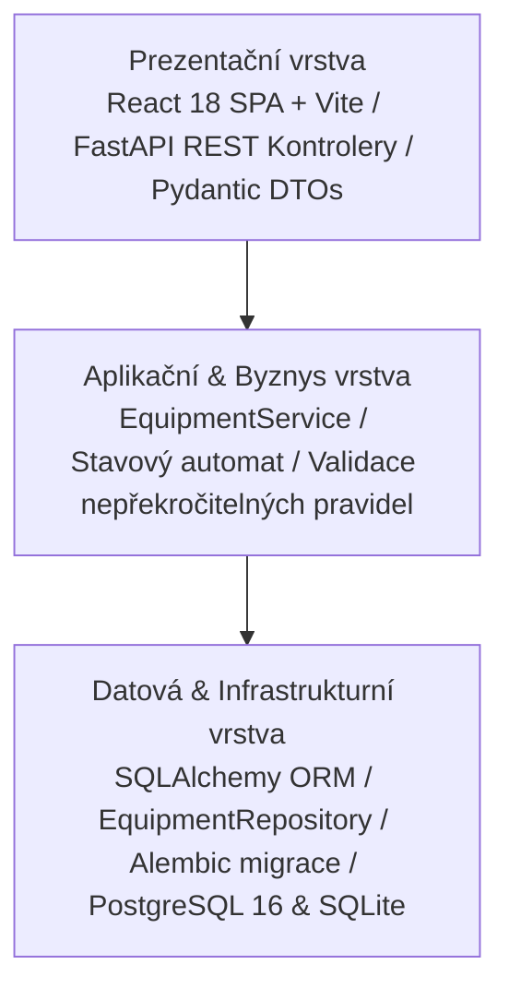
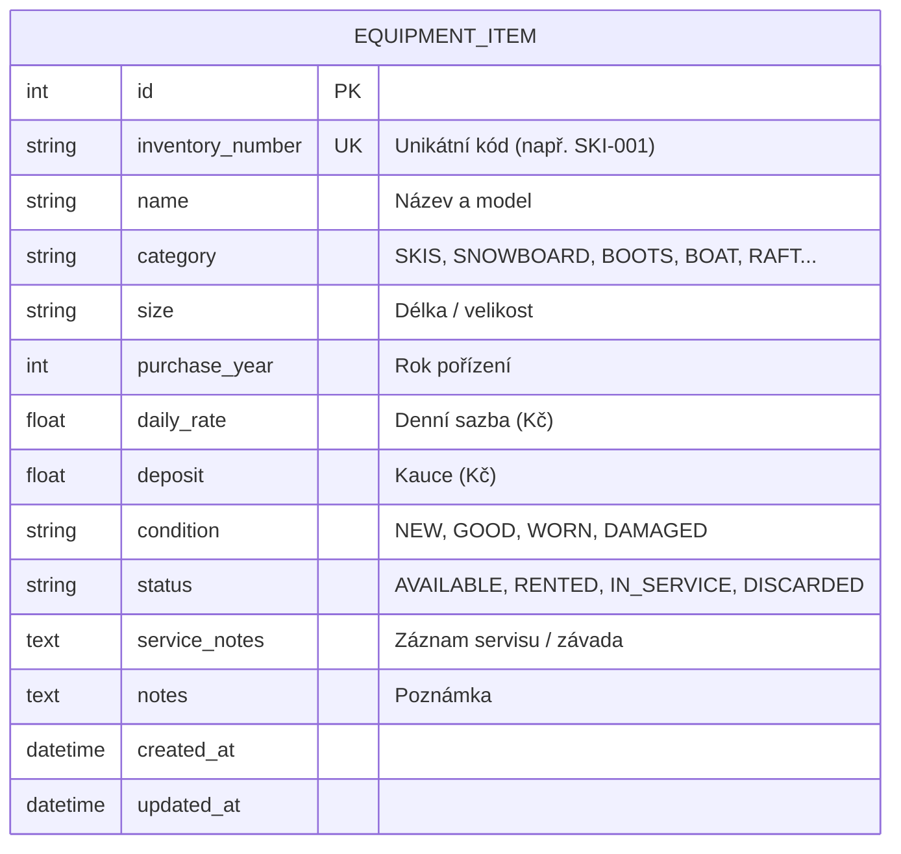
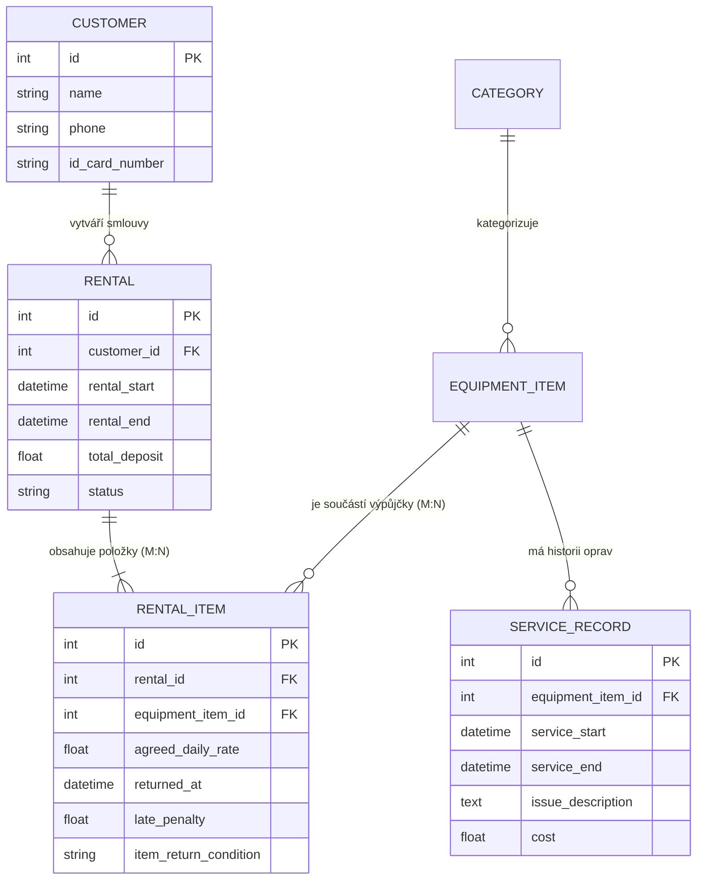

# Semestrální projekt PPRO – Pokročilé programování

**Předmět:** Pokročilé programování (PPRO)  
**Semestr:** Zimní semestr 2026/2027  
**Instituce:** Fakulta informatiky a managementu, Univerzita Hradec Králové  
**Konzultace vyučujícího:** Dominik Palla (`dominik.palla@uhk.cz`)  
**Autor projektu:** sirokvo1  
**Stav dokumentu:** Jediný zdroj pravdy (Single Source of Truth – SSOT)

---

## 1. Povinné společné minimum projektu

Aplikace musí splňovat následující kritéria definovaná zadáním:

- [x] **Tři vrstvy se závislostmi jedním směrem:**
  - *Prezentační vrstva* (React UI dashboard / FastAPI REST kontrolery a Pydantic DTOs)
  - *Aplikační / Byznys vrstva* (`EquipmentService`, validace unikátnosti kódů, stavový automat, servisní pravidla)
  - *Datová / Infrastrukturní vrstva* (SQLAlchemy ORM, `EquipmentRepository`, Alembic migrace, PostgreSQL v Dockeru / SQLite)
  - Závislosti striktně jednosměrné (Prezentace $\rightarrow$ Byznys $\rightarrow$ Data).
- [x] **Relační databáze v Dockeru s migracemi:** Schéma verze řízeno striktně migračními skripty Alembic (`001_initial_equipment.py`, `002_phase2_full_model.py`).
- [x] **Datový model:** Plný 6-entitní model (`Category`, `EquipmentItem`, `Customer`, `Rental`, `RentalItem` – vazba M:N, `ServiceRecord`).
- [x] **Automatizované testy:** Pytest testy byznys pravidel, stavových přechodů, blokace překryvů, výpočtu penále a REST API integrační testy (12 testů, 100% úspěšnost).
- [x] **Spuštění jedním příkazem:** Kompletní stack (databáze + backend + frontend) spustitelný přes `docker compose up --build`.
- [x] **Syntetická data:** Bezpečná syntetická testovací data (18 reálných položek půjčovny – lyže, snowboardy, kanoe, rafty, vesty) s automatickým seedem.
- [x] **Technická dokumentace:** Tento soubor (`README.md`) udržovaný jako aktuální zdroj pravdy (SSOT).

---

## 2. Výběr klientského zadání

> [!IMPORTANT]
> Volbu konkrétního zadání je nutné potvrdit **nejpozději na 4. cvičení** společně s návrhem datového modelu.

Níže je přehled 4 klientských zadání ze zadání předmětu:

- [ ] **Zadání A: Rezervace v ordinaci** *(MUDr. Jana Hrubá, Ordinace Na Vyhlídce)*  
  *Kde se láme návrh:* Překrývání termínů a význam zrušené rezervace.
- [ ] **Zadání B: Sklad pro malý e-shop** *(Petr Doležal, Dřevěnka s.r.o.)*  
  *Kde se láme návrh:* Okamžik odečtení zásoby a dohledatelnost pohybů.
- [ ] **Zadání C: Kurzy vzdělávacího centra** *(Ing. Lucie Bartošová, Akademie Trutnov)*  
  *Kde se láme návrh:* Pořadník a pravidlo dokončení kurzu.
- [x] **Zadání D: Půjčovna vybavení** *(Martin Řehák, Hory a voda)* – **ZVOLENO PRO IMPLEMENTACI**  
  *Kde se láme návrh:* Rezervace konkrétního kusu proti rezervaci typu.  
  *Technologický stack:* **React 18 + Vite + TypeScript (UI)** + **Python FastAPI (Backend)** + **PostgreSQL 16 (Docker)**  
  *Průběžný seznam úkolů:* [TODO.md](file:///p:/ppro/project/TODO.md)

---

## 3. Detailní specifikace jednotlivých zadání

<details>
<summary><strong>Rozbalit Zadání A: Rezervace v ordinaci</strong></summary>

### Klient
**MUDr. Jana Hrubá, Ordinace Na Vyhlídce.** Soukromá praxe, tři lékaři na částečné úvazky a paní Věra na recepci. Cca 900 pacientů (polovina pravidelných).

### Současný stav
Papírový diář na recepci, zápis tužkou. Při nemoci lékaře ruční obvolávání. Na konci měsíce ruční přepis výkonů do tabulky pojišťovny (celý podvečer). Problém: občasný souběh dvou pacientů na stejný čas.

### Co klient chce
1. **Pacienti v evidenci:** Jméno, příjmení, rok narození, telefon, rodné číslo / identifikátor pojištěnce, pojišťovna. Vyhledávání podle příjmení nebo telefonu.
2. **Lékaři a ordinační hodiny:** Každý lékař jiné dny a časy (jeden ordinující v úterý jinde, kde nelze objednávat).
3. **Rezervace na konkrétní termín u lékaře:** Zakládá recepce, s poznámkou důvodu návštěvy.
4. **Záznam o návštěvě:** Zápis provedených výkonů z číselníku (kód, název, body, volitelně počet opakování na návštěvě).
5. **Zrušení rezervace:** Evidence zrušení a přehled pacientů, kteří ruší opakovaně.
6. **Přehled volných termínů:** Zobrazení volných oken pro lékaře a týden (nejpoužívanější funkce).
7. **Měsíční výkaz:** Seznam výkonů a součet bodů za lékaře a měsíc pro pojišťovnu.

### Na čem klient trvá
- Dvě rezervace na stejný termín u stejného lékaře **nesmí jít založit** (ani omylem).
- Rezervaci nelze založit mimo ordinační hodiny daného lékaře.
- Výkon nelze zapsat k neuskutečněné návštěvě.
- Historie pacienta se **nikdy nemaže** (auditovatelnost).

### Co klient prohodil mimochodem
- Snadné ovládání pro paní Věru (nízká IT gramotnost).
- Rychlost odezvy při zvonícím telefonu.
- Možné zobrazení na tabletu (nespěchá).
- Obavy ze samoobslužného objednávání pacientů přes web.

### Otevřené body klienta
1. **Délka jednoho termínu:** Pevná mřížka (např. 15 minut) vs. dynamická délka dle typu výkonu.
2. **Kdo zakládá rezervaci:** Výhradně recepce vs. možnost pacientského portálu.
3. **Co se zrušenou rezervací:** Zmizení z kalendáře vs. zachování ve statistikách rušení.
4. **Identifikace pacienta:** Řešení duplicitních zápisů téže osoby.
5. **Nemoc lékaře:** Hromadné zrušení, přesun na zástup nebo označení k obvolání.

</details>

<details>
<summary><strong>Rozbalit Zadání B: Sklad pro malý e-shop</strong></summary>

### Klient
**Petr Doležal, Dřevěnka s.r.o.** Dřevěné hračky, 10 let praxe, růst tržeb.

### Současný stav
Excel se 400 položkami sdílený na 3 PC. Dva sklady: hlavní (Hradec Králové) a sezónní sklad/garáž (Třebechovice). Objednávky z e-mailu ručně. Problém: prodej zboží, které není skladem.

### Co klient chce
1. **Produkty a kategorie:** Název, kód, popis, nákupní a prodejní cena, vazba M:N do více kategorií.
2. **Zásoby po skladech:** Stav kusů odděleně pro Hradec a Třebechovice.
3. **Objednávky zákazníků:** Zákazník, datum, stav, položky (množství, prodejní cena).
4. **Odmítnutí objednávky při nedostatku zásob:** Klíčový důvod systému.
5. **Dohledání pohybu:** Skladová karta a historie výdejů pro každý kus.
6. **Přesun mezi sklady:** Evidence převozů mezi garáží a hlavním skladem.
7. **Minimální zásoba a doobjednání:** Seznam produktů pod limitem na hlavní stránce.
8. **Měsíční obrat po kategoriích:** Finanční reporting.

### Na čem klient trvá
- Vydat víc, než je skladem, **nesmí být možné**.
- Cena v odeslané objednávce je fixní a nesmí se změnit při úpravě ceníku.
- Každá změna stavu zásob musí být zpětně dohledatelná.
- Zákazník se nemaže (reklamace).

### Co klient prohodil mimochodem
- Poštovné neřešit (dělá e-shop).
- Responzivita pro mobilní telefon ve skladu.
- Fakturace výhledově.
- Barevné zvýraznění urgentních položek.

### Otevřené body klienta
1. **Objednávka ze dvou skladů naráz:** Možnost rozdělení výdeje a logistika.
2. **Definice „dostatečné zásoby“:** Fyzický stav vs. disponibilní stav (ponížený o rezervace).
3. **Záporný stav a inventura:** Striktní zákaz záporu vs. možnost vyrovnání manka inventurou.
4. **Varianty produktu:** Samostatné produkty s vazbou vs. atributy produktu.
5. **Změna objednávky po zaplacení:** Povolené stavy a storno proces.

</details>

<details>
<summary><strong>Rozbalit Zadání C: Kurzy vzdělávacího centra</strong></summary>

### Klient
**Ing. Lucie Bartošová, Akademie Trutnov.** Rekvalifikační a firemní kurzy, cca 40 ročně, externí lektoři.

### Současný stav
E-mailové přihlášky přepisované do tabulek (záložka na kurz). Pořadník tužkou na papíře. Osvědčení ve Wordu, riziko duplicity čísel. Problém: odřeknutí na poslední chvíli a složité dohledávání náhradníků.

### Co klient chce
1. **Kurzy:** Název, anotace, rozsah v hodinách, cena, příznak akreditace.
2. **Termíny kurzů:** Datum od-do, místo konání, kapacita (dle konkrétní učebny).
3. **Lektoři a přiřazení:** Vazba lektorů na termíny, střídání lektorů na delších kurzech.
4. **Přihlášky studentů:** Vazba studentů na termíny kurzů.
5. **Kapacita a pořadník (Waitlist):** Automatické zařazení do pořadí při naplnění a uvolnění místa.
6. **Docházka:** Evidence účasti po jednotlivých dnech.
7. **Dokončení a osvědčení:** Generování unikátního čísla osvědčení pro úspěšné absolventy.
8. **Přehledy:** Vytíženost termínů, odučené hodiny lektorů, studenti s více kurzy.

### Na čem klient trvá
- Kapacitu termínu **nelze překročit**.
- Pořadí v pořadníku se **nesmí přeskakovat**.
- Číslo osvědčení je striktně unikátní a vydané osvědčení se nemění.
- Zrušená přihláška zůstává v auditním záznamu.

### Co klient prohodil mimochodem
- Fakturaci nechat na budoucí rozšíření.
- Jednoduché UI pro starší lektory.
- Uvítala by automatické e-maily studentům.
- Ruční exporty do výkazu pro ministerstvo.

### Otevřené body klienta
1. **Pravidlo pro dokončení kurzu:** Striktní docházka (např. 70 %) vs. manuální posouzení lektorem.
2. **Posun z pořadníku:** Automatické zapsání náhradníka vs. notifikace s potvrzením zájmu.
3. **Souběh dvou termínů téhož kurzu:** Povolit zápis na více termínů současně či blokovat.
4. **Přihlášení po zahájení kurzu:** Striktní zákaz vs. schválená výjimka.
5. **Výpočet hodin při více lektorech:** Dělení hodin mezi střídající se lektory.

</details>

<details>
<summary><strong>Rozbalit Zadání D: Půjčovna vybavení</strong></summary>

### Klient
**Martin Řehák, Hory a voda.** Půjčovna lyží, snowboardů a lodí. Krátká sezóna, nárazový provoz a fronty o víkendech.

### Současný stav
Sešit a inventární čísla lihovkou na vybavení. Telefonické rezervace na lístečcích. Problém: dvojí slíbení stejného kusu vybavení, časový pres v sobotu ráno.

### Co klient chce
1. **Jednotlivé kusy vybavení:** Inventární číslo, kategorie, velikost, rok pořízení, opotřebení. Každý kus samostatným záznamem.
2. **Kategorie vybavení:** Lyže, boty, hole, lodě, vesty atd. (určují cenotvorbu).
3. **Zákazníci:** Jméno, telefon, číslo dokladu, výše kauce.
4. **Výpůjčky:** Vazba zákazníka na více kusů, datum od-do.
5. **Rezervace předem:** Rezervační kalendář na budoucí termíny.
6. **Částečné vrácení:** Možnost vrátit část výpůjčky (např. lyže dříve než boty).
7. **Servisní odstávka:** Vyřazení kusu z půjčování po dobu servisu a sledování délky servisu.
8. **Ceník dle dnů:** Diferencované sazby (zvláštní víkendový tarif od pátečního odpoledne).
9. **Přehledy:** Aktuálně zapůjčené kusy, prodlení s vrácením, statistika vytíženosti kusů.

### Na čem klient trvá
- Jeden kus **nesmí** být ve dvou překrývajících se výpůjčkách či rezervacích.
- Kus v servisu nelze půjčit ani rezervovat na dané období.
- Za pozdní vrácení se automaticky účtuje penále za každý započatý den.
- Historie výpůjček se nemaže (reklamace, rozhodování o obnově fondu).

### Co klient prohodil mimochodem
- "Dashboard" pro sobotní ranní špičku (okamžitý přehled volných kusů na jedné obrazovce).
- Kauce v hotovosti (nemusí jít přes systém).
- Možnost manuální slevy obsluhou.
- Tisk předvyplněné smlouvy o výpůjčce.

### Otevřené body klienta
1. **Předmět rezervace:** Rezervace konkrétního inventárního čísla vs. rezervace kapacity v kategorii a velikosti.
2. **Expirace nevyzvednuté rezervace:** Čas propadnutí rezervace v den výpůjčky.
3. **Evidence poškození:** Vazba škody na konkrétní kus, smlouvu nebo srážku z kauce.
4. **Účtování při částečném vrácení:** Uzavírání položek vs. celé smlouvy a výpočet penále.
5. **Sezónní změny ceníku:** Garance původní ceny ze sjednané smlouvy při aktualizaci ceníku.

</details>

---

## 4. Oddíl Rozhodnutí (Architecture & Business Decisions Log)

> [!NOTE]
> Podle pravidel předmětu PPRO do tohoto oddílu patří **jedna až dvě věty na každý otevřený bod klienta: jak jste to vyřešili a proč**.
> Tento seznam slouží jako primární podklad při obhajobě před vyučujícím.

*(Rozhodnutí pro Zadání D: Půjčovna vybavení „Hory a voda“)*

| ID | Otevřený bod klienta | Zvolené řešení | Odůvodnění (Proč) |
|---|---|---|---|
| **OB-1** | **Předmět rezervace:** Konkrétní inventární číslo vs. rezervace kapacity kategorie a velikosti. | Rezervace a výpůjčka se váže na konkrétní unikátní kus (`inventory_number`). | Každý kus má specifické opotřebení, délku a servisní historii; vazba na unikátní kód eliminuje riziko, že by se stejný kus slíbil dvěma zákazníkům. |
| **OB-2** | **Expirace nevyzvednuté rezervace:** Čas propadnutí rezervace v den výpůjčky. | Rezervace propadá automaticky 60 minut po sjednaném čase vyzvednutí. | V ranní sobotní špičce nelze blokovat vybavení celou směnu, nevyzvednutý kus se ihned uvolní do stavu `AVAILABLE` pro čekající frontu. |
| **OB-3** | **Evidence poškození:** Vazba škody na kus, smlouvu nebo srážku z kauce. | Závada se eviduje servisním zásahem (`ServiceAction`) a stav kusu přechází do `IN_SERVICE`. | Umožňuje okamžité vyřazení z fondu k opravě, vyčíslení nákladů opravy ze složené kauce a audit historie opotřebení. |
| **OB-4** | **Účtování při částečném vrácení:** Uzavírání položek vs. celé smlouvy a penále. | Každá položka ve vazbě M:N (`RentalItem`) má vlastní čas vrácení a stav; kauce se zúčtovává při vrácení posledního kusu. | Zákazník může vrátit např. lyže v neděli a boty v pondělí, systém spočítá penále pouze za skutečně prodlené položky. |
| **OB-5** | **Sezónní změny ceníku:** Garance původní ceny ze sjednané smlouvy při aktualizaci ceníku. | Sjednaná denní sazba a kauce se kopírují přímo do řádku smlouvy (`RentalItem.agreed_daily_rate`) v okamžiku vzniku. | Změna globálního ceníku nesmí retroaktivně ovlivnit dříve uzavřené či rezervované smlouvy. |

---

## 5. Návrh architektury a technického řešení

### 5.1 Vrstvy aplikace (jednosměrná závislost)



- **Prezentační vrstva:** Moderní React dashboard optimalizovaný pro ranní víkendovou špičku (rychlé fulltext hledání, filtrovací čipy kategorií, barevné indikátory stavů, modální formuláře). Na backendu FastAPI endpointy (`/api/v1/equipment`).
- **Aplikační vrstva:** Zapouzdřuje obchodní pravidla v `EquipmentService`. Hlídá unikátnost inventárních čísel, povolené stavové přechody (`AVAILABLE` $\leftrightarrow$ `IN_SERVICE`, `AVAILABLE` $\rightarrow$ `RENTED`, přechod do `DISCARDED`) a striktní pravidlo, že kus v servisu nesmí být půjčen.
- **Datová vrstva:** `EquipmentRepository` poskytuje abstrakci nad databázovým přístupem. Schéma je verzováno migracemi Alembic (`001_initial_equipment.py`). Podporuje PostgreSQL v Dockeru i SQLite pro lokální testy.

### 5.2 Datový model (ER diagram)

#### Implementováno ve Fázi 1 (Klientský prototyp):


#### Plný cílový model (Fáze 2 – 5 entit a vazba M:N):


---

## 6. Provozní instrukce a spuštění

### 6.1 Prerekvizity
- Docker a Docker Compose (pro produkční/odevzdané prostředí)
- Python 3.12 a Node.js 20+ (pro lokální vývoj mimo Docker)

### 6.2 Spuštění aplikace v Dockeru (doporučeno pro odevzdání)
Celý systém (PostgreSQL databáze + FastAPI backend + React/Nginx frontend) se spouští jediným příkazem:
```bash
docker compose up --build
```
- **Webová aplikace (Frontend):** [http://localhost:80](http://localhost:80) nebo [http://localhost:5173](http://localhost:5173)
- **API Swagger dokumentace:** [http://localhost:8000/api/v1/docs](http://localhost:8000/api/v1/docs)
- **API Health Check:** [http://localhost:8000/health](http://localhost:8000/health)

### 6.3 Lokální spuštění bez Dockeru (rychlý vývoj)
Díky modulární architektuře s fallbackem na SQLite lze aplikaci spustit i přímo lokálně:
```bash
# 1. Spuštění backendu (FastAPI automaticky inicializuje DB a seeduje vzorová data):
cd backend
py -3.12 -m uvicorn app.main:app --port 8000

# Webové rozhraní i API je ihned dostupné na http://127.0.0.1:8000
```

### 6.4 Běh automatizovaných testů
Sada jednotkových a integračních testů ověřuje byznys logiku a API:
```bash
py -3.12 -m pytest
```

---

## 7. Deník vývoje (Changelog)

- **2026-11-26:**
  - **FÁZE 2 – Plný datový model (6 entit vč. vazby M:N) a klíčová byznys pravidla:**
    - **Datová vrstva & migrace:** Přidány SQLAlchemy modely `Category`, `Customer`, `Rental`, `RentalItem` (vazba M:N mezi výpůjčkou a kusem vybavení) a `ServiceRecord`, propojení `EquipmentItem.category_id` FK a Alembic migrace `002_phase2_full_model.py`.
    - **Byznys vrstva:** Implementovány služby `CategoryService`, `CustomerService`, `RentalService` a `ServiceRecordService`. Striktně vynucena pravidla: zákaz překrývajících se výpůjček/rezervací téhož kusu, zákaz půjčení kusu v servisu/vyřazeného, automatický výpočet penále za každý započatý den prodlení, podpora částečného vrácení (OB-4), fixace sjednané sazby (OB-5), nemazání historie výpůjček a automatické zakládání/uzavírání `ServiceRecord` (OB-3).
    - **REST API & Seed:** Nové endpointy `/api/v1/categories`, `/api/v1/customers`, `/api/v1/rentals` (vč. `/activate`, `/cancel`, `/items/{id}/return`) a `/api/v1/service-records`. Rozšířen `seed.py` o syntetické kategorie, zákazníky, aktivní/prodlené výpůjčky, rezervaci a servisní záznamy.
    - **Frontend (Neo-Brutalismus):** Přidána horní navigace (`01_VYBAVENÍ`, `02_VÝPŮJČKY`, `03_ZÁKAZNÍCI`, `04_CENÍK`) a komponenty `RentalsView.tsx`, `CustomersView.tsx`, `CategoriesView.tsx`.
    - **Testy:** Rozšířeno na 12 automatizovaných Pytest testů (všechny 100% úspěšné) + ověřen produkční Vite build frontendu.
- **2026-10-07:**
  - **Reakce na zpětnou vazbu klienta (Přepracování wireframu a stylu na Minimalistický Neo-Brutalismus):**
    - Klient odmítl generický layout plovoucích SaaS karet s požadavkem na svébytný wireframe a styl minimalismu spojeného s brutalismem.
    - **Nový wireframe (Split Dispatch Desk):**
      - Asymetrické rozdělení na levý navigační panel ([Sidebar.tsx](file:///p:/ppro/project/frontend/src/components/Sidebar.tsx)) s přímým přepínáním stavů fondu a kategorií s počty v hranatých závorkách `[05]` a pravý hlavní manifest.
      - Horní dispečerská lišta s integrovaným vyhledáváním a telemetrickými údaji přímo nad inventární tabulkou namísto generického pruhu filtrů.
    - **Vizuální styl Minimalistický Neo-Brutalismus:**
      - Zřetelné masivní linky (`border: 2px solid #1a1614`), ostré pravé úhly bez bublinkových zaoblení.
      - Mechanický haptický efekt tlačítek a známek s tvrdým odsazeným stínem (`box-shadow: 2px 2px 0px #1a1614` / `3px 3px 0px #1a1614`) a fyzickým stiskem při kliknutí.
      - Písmo `JetBrains Mono` pro inventární kódy `[SKI-001]`, ceny a technická data kombinované se strukturovanou sans-serif typografií.
      - Přirozený teplý tón surového papíru a kartonu (`#f4efe6`, `#e8dfd1`) v kombinaci s tiskařskou černí a akcenty terakoty, okru a lesního mechu.
  - **FÁZE 1 – Implementace klientského MVP prototypu (Zadání D: Půjčovna vybavení „Hory a voda“):**
    - Vytvoření 3-vrstvé architektury se striktně jednosměrnými závislostmi.
    - **Datová vrstva:** SQLAlchemy model `EquipmentItem`, migrační skript Alembic `001_initial_equipment.py`, `EquipmentRepository` pro CRUD a filtrování.
    - **Byznys vrstva:** `EquipmentService` s validací unikátnosti inventárních kódů, stavovým automatem (`AVAILABLE`, `RENTED`, `IN_SERVICE`, `DISCARDED`) a ochranou proti půjčení kusu v servisu.
    - **Prezentační vrstva:**
      - FastAPI REST API kontrolery (`/api/v1/equipment`, `/api/v1/equipment/stats`, `/api/v1/equipment/{id}/service`).
      - Moderní React 18 + TypeScript SPA dashboard s kartami statistik, rychlými filtry pro ranní víkendovou špičku, modálním zaevidováním kusů a obsluhou servisních odstávek.
    - **Syntetická data:** Automatické seedování 18 realistických kusů vybavení (sjezdové lyže Atomic, carvingové Salomon, snowboardy Burton, skialpy, kanoe Vydra, rafty Colorado, vesty, helmy) v různých stavech.
    - **Testování:** 7 automatizovaných Pytest testů pokrývajících byznys logiku i HTTP endpointy (100% úspěšnost).
    - **Dockerizace:** `docker-compose.yml`, `backend/Dockerfile`, `frontend/Dockerfile` + `nginx.conf`.
    - Aktualizace sekce Rozhodnutí (vyřešení všech 5 otevřených bodů klienta OB-1 až OB-5) a [TODO.md](file:///p:/ppro/project/TODO.md).
- **2026-09-30:**
  - Inicializace Git repozitáře a napojení na GitHub (`BaspelOp/ppro-project`).
  - Vytvoření [AGENTS.md](file:///p:/ppro/project/AGENTS.md) s pravidly pro asistenta (zásady commitů s `-m`, explicitní push, SSOT dokumentace, krokování úkolů).
  - Vytvoření [README.md](file:///p:/ppro/project/README.md) jako jediného zdroje pravdy pro zadání, pravidla PPRO a seznam rozhodnutí.
  - Nastavení pre-commit hooku pro kontrolu aktuálnosti technické dokumentace.
  - Výběr Zadání D (Půjčovna vybavení „Hory a voda“) a technologického stacku (React + TypeScript + FastAPI + PostgreSQL).
  - Vytvoření [TODO.md](file:///p:/ppro/project/TODO.md) pro krokování a odškrtávání jednotlivých fází a featur.

